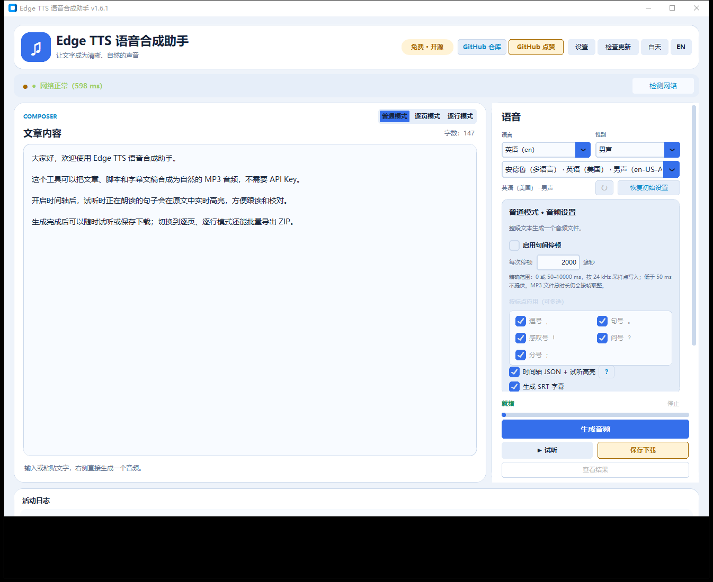
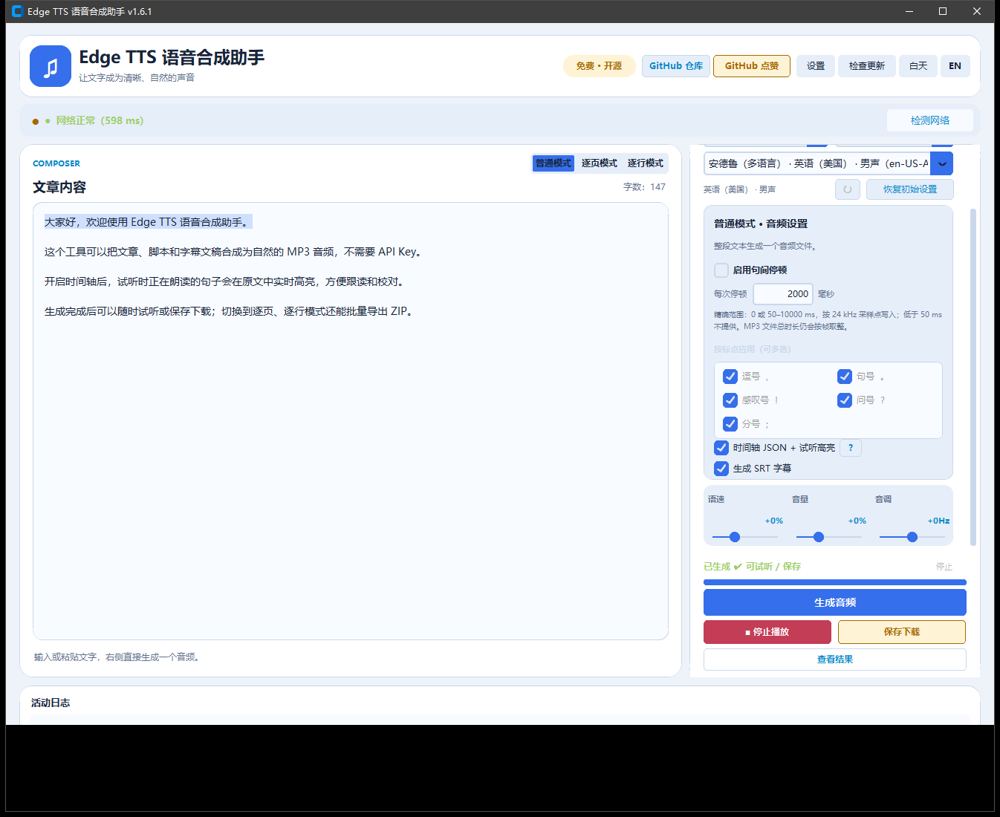
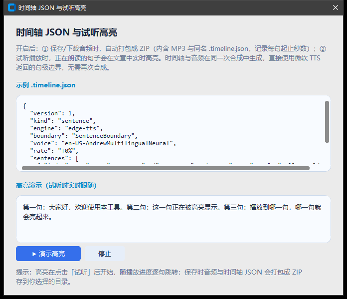
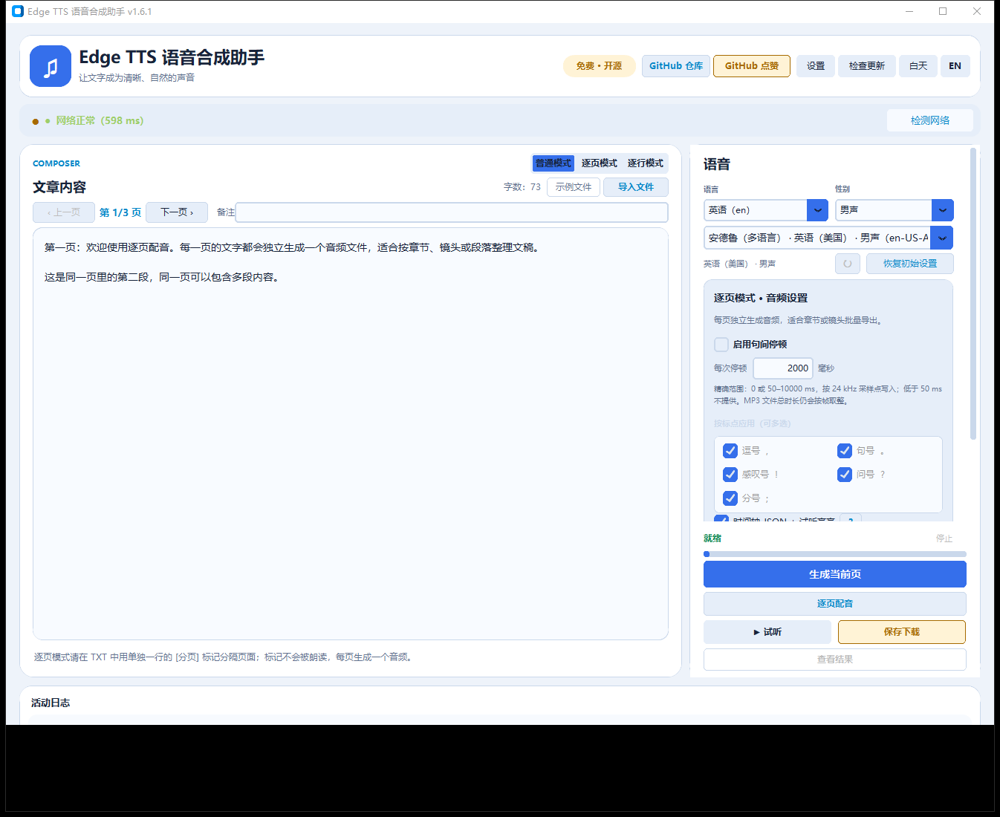
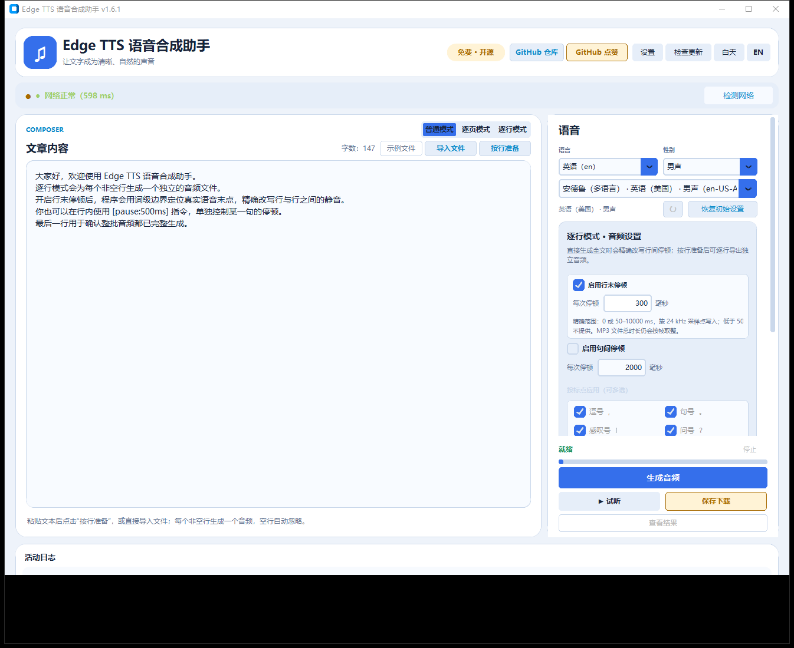
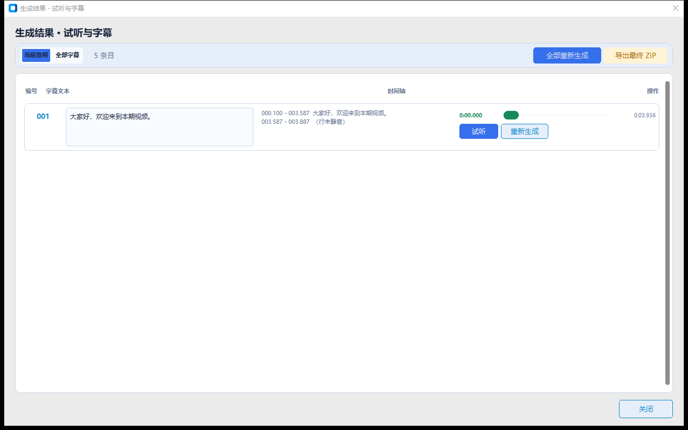
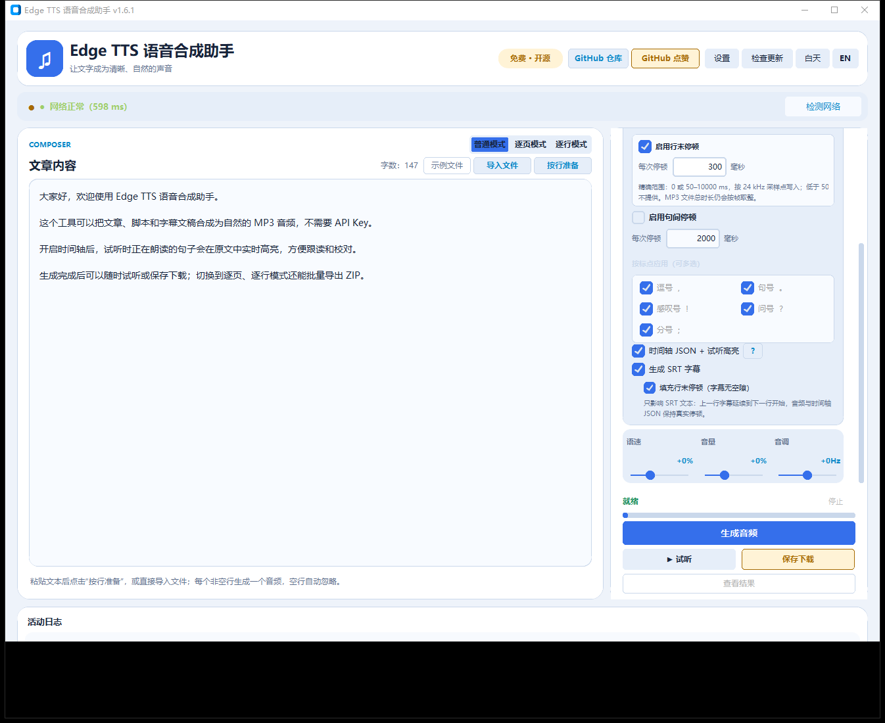

# 樺英雄语音合成助手 / HuayingxiongTTS
> 本软件基于 [JJosephph/ms-edge-tts-gui](https://github.com/JJosephph/ms-edge-tts-gui) 
> （MIT License）修改，原作者 **WangYufan**（QQ 1471056247）。
> 本分支由 **樺英雄 / HuaYingXiong**（QQ 562297979）维护与定制。
> > **Fork / 修改声明 · Fork Notice**
> 本分支基于 [JJosephph/ms-edge-tts-gui](https://github.com/JJosephph/ms-edge-tts-gui)（© WangYufan，MIT License）修改。
> 原项目：https://github.com/JJosephph/ms-edge-tts-gui
> 本分支新增修改版权归 **樺英雄 / HuaYingXiong**（QQ 562297979）所有。
> 与原作者无隶属关系，未获其背书。
> 
> This fork is based on [JJosephph/ms-edge-tts-gui](https://github.com/JJosephph/ms-edge-tts-gui) (© WangYufan, MIT License).
> Modifications copyright © 2026 HuaYingXiong / 樺英雄. No affiliation with or endorsement by the original author.
> 详细版权和许可证范围见 [FORK_NOTICE.md](FORK_NOTICE.md)。

---
> 感谢原作者的开源贡献！🙏
> ## 许可证 / License

本软件遵循 [MIT License](LICENSE.zh.txt)。
原项目版权归 WangYufan 所有，本分支新增修改版权归 樺英雄 所有。

<p align="center">
  <strong>Turn text into clear, natural voice.</strong><br>
  A polished, open-source desktop client for Microsoft Edge Text-to-Speech.
</p>

<p align="center">
  <a href="https://github.com/sjhznh/ms-edge-tts-gui/releases"></a>
  <a href="LICENSE"></a>
  
  
  <a href="https://github.com/sjhznh/ms-edge-tts-gui/stargazers"></a>
</p>

<p align="center">
  <a href="#中文说明">中文说明</a> ·
  <a href="#english-guide">English guide</a> ·
  <a href="#downloads">Downloads</a> ·
  <a href="#赞赏支持--support-the-author">支持作者</a> ·
  <a href="#network-and-proxy">Network &amp; proxy</a> ·
  <a href="#build-and-release">Build</a>
</p>

---

## 赞赏支持 / Support the Author

> **中文**：这个工具完全免费、开源（MIT License），没有广告，也没有任何付费功能。如果它确实帮到了你，欢迎扫码请本修改版维护者喝一杯咖啡，支持本分支继续维护和更新；不打赏也完全不影响使用，点个 Star 同样是最好的支持。
>
> **English**: This tool is free and open source under the MIT License, with no ads and no paid features. If it saves you time, you are welcome to buy the fork maintainer a coffee with the WeChat Pay QR code below. The project stays free either way, and a **Star** is just as valuable.

<p align="center">
  
</p>
<p align="center">
  <sub>微信扫码 · 金额随意 · 感谢支持 / Scan with WeChat · any amount · thank you</sub>
</p>

---

## ⭐ 求点赞 · 请先读我 / Star Us · Please Read First

> **中文**：本项目 **免费、开源（MIT License）**，维护者 **	
HuaYingXiong**（QQ 562297979）。
> 仓库地址：https://github.com/sjhznh/ms-edge-tts-gui
> 如果你觉得这个工具对你有帮助，请先到仓库点一个 **Star**，让更多用户能找到它；使用中遇到问题，欢迎提交 [Issue](https://github.com/sjhznh/ms-edge-tts-gui/issues) 或 PR。

> **English**: This project is **free and open source (MIT License)**, Maintained by **	
HuaYingXiong** (QQ 562297979).
> Repository: https://github.com/sjhznh/ms-edge-tts-gui
> If this tool helps you, please **Star** the repository first so more users can discover it; issues and pull requests are welcome.

---

## 中文说明

**Edge TTS 语音合成助手**是一款免费、开源的 Windows 桌面软件（MIT License，本修改版维护者 	
HuaYingXiong）。它把文章、脚本和字幕文稿合成为自然的 MP3 音频，不需要 API Key。软件提供**普通、逐页、逐行**三种工作模式，并支持独立句间停顿、行末真实静音、SRT 字幕、时间轴 JSON、逐句试听高亮、可拖动播放进度和批量 ZIP 导出。界面可随时切换中文和 English，适合旁白制作、视频剪辑、跟读学习和批量配音。

### v1.7.0 更新亮点

- **普通模式批量上传**：无需切换到独立模式，点击「批量上传」即可拖入或选择多个 `txt / md / docx / pdf`；原输入框会变成逐行文件列表，不点击时仍保持原有粘贴文本流程。
- **每个文件独立配置**：列表显示序号、文件名、音色、字数和进度；点击任意一行后，右侧音色、句间停顿、标点、SRT、时间轴、语速、音量、音调只作用于该文件。
- **文本规则标记**：可在每个文件第一行写入 `{Abeo|200ms{,.~}|srt}` 或完整的 `{tts:...}` 规则；导入时自动应用并从朗读文本中过滤。规则配置弹窗提供中文音色字典，可按语言、性别和关键词筛选，并可直接模拟设置、复制规则。
- **批量续跑与下载**：批量生成只处理未完成项，已完成文件不会重复合成；可打包下载全部完成项，也可右键某个已完成 `100%` 的文件单独下载 ZIP，或选中未完成项重试。
- **稳定性修复**：修复多个文件规则串用、普通批量误继承逐行模式行末停顿，以及中文/Unicode 输出文件名触发 `failed to decode file (-7)` 的问题。

- **生成、试听与保存**：一键生成全文音频；生成后可随时“试听”或“保存下载”，无需重复合成。播放中“试听”按钮会变成醒目的红色「■ 停止播放」，再点一次即可停止，音频播放结束也会自动还原。
- **三种工作模式**：普通模式直接读取输入框全文；逐页模式按 `[分页]` 标记生成一页一个音频；逐行模式可直接生成带精确行间停顿的全文，也可“按行准备”后为每个非空行导出独立音频。
- **实时进度**：生成时显示近似 `0–100%` 进度，完成后进度条保持 100%。
- **时间轴 JSON + 试听高亮**：主界面勾选后，保存/下载时自动打包 ZIP（内含 MP3 与同名 `.timeline.json`，每句起止秒数）；试听时正在朗读的句子会在文章中实时高亮。
- **结果表格浏览器**：批量结果按行展示文字、句级时间轴、试听和重新生成操作；悬停会高亮对应行，修改后的单行可以直接重新生成并继续导出最终 ZIP。
- **可拖动播放时间轴**：每行显示已播放秒数/总时长，绿色滑块可拖动跳转；播放进度和行末静音段都包含在总时长中。
- **独立句间停顿**：用词级边界定位真实语音末点，再替换原生间隔；时间轴、SRT 和音频同步更新，不改变人声语速。
- **行末停顿**：逐行模式会精确改写每一行之间的静音，并裁掉最后一行的原生尾静音后写入指定时长，不再受不同声音原生停顿长短影响。
- **SRT 字幕**：勾选“生成 SRT 字幕”后，每句对应一条字幕，时间严格匹配最终音频，可随 MP3 一起导出。
- **字幕填充行末停顿**：逐行模式开启行末停顿后，可让导出的 SRT 首尾相接，导入剪辑软件时时间轴不再有空缺，同时音频本身保持真实停顿。
- **网络保护**：生成前检测服务连接和代理环境变量；长时间无音频数据时会提示重试。
- **更新检测**：启动时自动检查 GitHub 最新正式版；顶部“检查更新”可手动检查，发现新版本时显示更新内容和下载入口。
- **三级语音选择**：语音一次性从远端拉取后在本地按 **语言 → 性别 → 音色** 分组（内置分组引擎），不用再大海捞针；默认保留 `en-US-AndrewMultilingualNeural`（英语男声），可随时自选。
- **音色自然丰富**：支持几百种语言、数百个音色，男声、女声都非常丰富；无论中文、粤语、英语还是其他外语，都是十分自然的 TTS 朗读，不是机器音——用过 Edge 朗读功能的人都懂。
- **兼容原工作流**：默认 `en-US-AndrewMultilingualNeural`，语速 `+0%`、音量 `+0%`、音调 `+0Hz`；「恢复初始设置」可一键还原。
- **不占空间**：生成的音频只保存在一个临时 MP3 里，可自定义目录、打开或清理，关闭软件时自动删除。
- **文件导入与示例**：普通模式支持批量上传，逐页、逐行模式支持 `txt / md / docx / pdf`；界面提供示例 TXT 下载按钮，方便按正确格式准备批量文稿。
- **批量文件列表**：普通模式点击「批量上传」后，原输入框会切换为文件列表（序号、文件名、音色、字数、进度）。选中任意一行后，右侧设置只作用于该文件；列表支持左侧复选框、表头全选、`Ctrl+A` 和 `Shift/Ctrl` 多选移除。批量生成只处理未完成项，完成后可打包下载，也可右键某个 100% 完成的文件单独下载 ZIP，或重试所选未完成项。
- **文本规则标记**：可在每个文件第一行写入音色、句间停顿、标点、SRT、时间轴 JSON、语速、音量、音调等规则，导入时自动应用并从朗读文本中过滤。

### 中文界面预览

<p align="center">

</p>
<p align="center">
<sub>v1.6.1 主界面 · 普通模式：左侧输入文稿，右侧选择语音、设置句间停顿、SRT 字幕和时间轴；顶部可切换普通 / 逐页 / 逐行三种工作模式。</sub>
</p>

### 亮点功能：时间轴 JSON + 试听逐句高亮

这是本工具最值得一试的功能。在主界面勾选「时间轴 JSON + 试听高亮」后：

- **保存即打包 ZIP**：点击「保存下载」时，自动生成一个 ZIP 压缩包，里面同时包含 MP3 和同名 `.timeline.json`——每句话的起止秒数清清楚楚，不用手动配对；
- **试听实时高亮**：点击「试听」后，正在朗读的句子会在原文中逐句点亮，像 K 歌字幕一样跟着进度走，跟读复习特别方便；
- **精准且零额外合成**：MP3 与时间轴在同一次请求中生成，时间轴直接使用微软 TTS 返回的句级边界，**不需要再次合成**，纯本地保存、完全免费、无需 API Key。

<p align="center">

</p>
<p align="center">
  <sub>试听逐句高亮：播放时正在朗读的句子会实时点亮，同时“试听”按钮变成红色「■ 停止播放」。</sub>
</p>
<p align="center">

</p>

`.timeline.json` 内容示例：

```json
{
  "boundary": "SentenceBoundary",
  "sentences": [
    { "index": 0, "text": "你好，欢迎使用 Edge TTS 语音合成助手。", "start": 0.00, "end": 3.12 },
    { "index": 1, "text": "时间轴来自微软 TTS 的句级边界，无需二次合成。", "start": 3.12, "end": 6.80 }
  ]
}
```

> 适用场景：视频字幕、剪辑对齐、外语跟读、逐句复习、播客文稿等。

### 三种工作模式

#### 1. 普通模式

默认模式无需导入文件，也不要求分页。把完整文稿粘贴到左侧输入框，点击「**生成音频**」即可得到一个 MP3。输入框里的换行只作为朗读文本的一部分，不会自动拆成多个文件。

##### 普通模式 · 批量上传

点击「**批量上传**」后，可在一个窗口中拖入多个 `txt / md / docx / pdf` 文件，或点击「选择多个文件」。确认后，普通模式的输入框会切换成文件列表；未点击批量上传时，粘贴文本的原有流程完全不变。

- 列表显示序号、文件名、当前音色、字数和生成进度。
- 点击任意一行，右侧的音色、停顿、字幕、时间轴、语速、音量、音调只配置该文件。
- 左侧复选框和表头全选可用于批量移除；列表内支持 `Ctrl+A`，并支持 `Shift/Ctrl` 多选。点击「**批量生成**」时只处理未完成项，已完成文件会保留，不会重复生成。
- 音频名称默认使用 TXT 文件名；点击「打包下载全部完成项」可下载所有已完成项，也可在列表中右键某个已完成 `100%` 的文件单独下载 ZIP，或右键重试所选未完成项。
- 单个 ZIP 同样包含音频、SRT 字幕、时间轴 JSON 和 `metadata.json`。

每个文本文件可以在第一行加入规则标记，例如：

```text
{Abeo|200ms{,.~}|srt}
这是正文第一句。这一行不会朗读规则标记。
```

更完整的写法：

```text
{tts:Ana|pause=200ms|marks=,.!?|srt=1|json=1|rate=+10%|volume=+0%|pitch=+0Hz}
```

字段含义：`voice/v` 音色，`pause` 句间停顿，`marks` 标点，`srt` 字幕，`json` 时间轴，`rate` 语速，`volume` 音量，`pitch` 音调。普通模式没有“行”的概念，因此普通批量规则不包含 `line` / `fill`，也不继承逐行模式的行末停顿；行末停顿只在逐行模式提供。界面里的「**规则配置**」按钮可以查看音色字典、模拟右侧设置并复制规则编码；音色选择同样按「语言 → 性别 → 音色」三级进行，字典带中文名、语言、性别表头，并支持按语言、性别和关键词筛选。

#### 2. 逐页模式

适合按章节、镜头或段落生成音频。点击「**导入文件**」选择 `txt / md / docx / pdf`，TXT/Markdown 推荐使用单独一行的 `[分页]` 标记：

```text
这是第一页的内容。
[分页]
这是第二页的内容。
[分页]
这是第三页的内容。
```

`[分页]` 不会被朗读。没有显式标记时，文本中的空行块也可以作为页面。每页支持备注，备注不会朗读，会写入 `pages.json`。点击「**逐页配音**」后，每页生成一个 MP3，最后可导出 ZIP。

<p align="center">

</p>
<p align="center">
  <sub>逐页模式：左上角切换「逐页模式」，导入 txt / md / docx / pdf 后逐页核对文字与备注，再点击「逐页配音」批量生成。</sub>
</p>

#### 3. 逐行模式

适合视频解说、短句旁白和批量字幕。可以导入 TXT，也可以直接粘贴文本后点击「**按行准备**」：每个非空行生成一个独立音频，空行自动忽略。

```text
第一句旁白，生成 line_001.mp3
第二句旁白，生成 line_002.mp3
第三句旁白，生成 line_003.mp3
```

点击「**逐行配音**」后，软件按行顺序合成，完成后保存为 ZIP，包含 `line_001.mp3`、`line_002.mp3` 等音频以及 `lines.json`。打开「查看结果」后，可切换“当前音频 / 全部字幕”，在同一行编辑文字、查看时间轴、试听、拖动进度和重新生成；全部确认后可直接导出最终 ZIP。逐页和逐行模式都提供「**示例文件**」按钮。

<p align="center">

</p>
<p align="center">
  <sub>逐行模式：粘贴文本后点击「按行准备」（或直接导入文件），每个非空行对应一个音频，可逐行翻页核对。</sub>
</p>

### 字幕与「查看结果」预览

生成完成后点击主界面的「**查看结果**」，可以在同一个窗口里完成预览、校对和导出，适合批量配音的最后检查：

- **试听 / 停止**：每一行都有独立的「试听」按钮，播放时会变成红色「**停止**」，再点一次即停止；正在播放的那一行会高亮显示。
- **可拖动的进度条**：每行显示 `已播放 / 总时长`（精确到毫秒），绿色滑块可以直接拖动跳转到任意位置，行末静音的时长也计算在内。
- **字幕文本 + 时间轴**：中间列显示每个音频的句级时间轴（起始 / 结束秒数 + 该句字幕文本），与「生成 SRT 字幕」导出的内容一致，方便逐句核对。
- **修改后重新生成**：左侧文本框可以直接编辑旁白文字，点「重新生成」只重做这一行；也可以「全部重新生成」。
- **当前音频 / 全部字幕**：顶部开关可在“只看当前一条”和“查看全部条目”之间切换，批量结果一目了然。
- **导出最终 ZIP**：确认无误后点「导出最终 ZIP」，把音频、SRT 字幕和时间轴 JSON 一起打包保存。

<p align="center">

</p>
<p align="center">
  <sub>「查看结果」· 全部字幕视图：编号、字幕文本、时间轴、试听 / 重新生成、可拖动进度条一屏完成校对。</sub>
</p>

### 句间停顿与字幕

- 在右侧「**默认句间停顿**」输入毫秒数：支持 `0`，或 `50–10000 ms`。设置值会替换 Edge TTS 原生句间空隙，不改变人声语速。
- 逐行模式开启「**行末停顿**」后，程序使用微软词级边界定位每行真实语音末点，再按采样点写入指定静音。直接生成全文时控制行与行之间的间隔；按行批量导出时控制每个独立音频的尾部静音。
- 低于 `50 ms` 的非零停顿不提供：24 kHz MP3 每帧为 48 ms，更短的值无法稳定听辨或验证。需要删除原生停顿时请使用 `0 ms`。静音位置按 PCM 采样点写入，但 MP3 文件总时长仍可能按帧取整。
- 点击编辑区上方「**句末停顿**」可批量插入停顿指令；也可以手动写入 `[pause:500ms]`、`[pause:1.5s]`、`[pause:weak]`、`[pause:medium]`、`[pause:strong]` 或 `[pause]`。这些指令不会被朗读，单句指令优先于全局默认值。
- 开启「**生成 SRT 字幕**」后，每句生成一条字幕；字幕时间会包含句间停顿，和最终 MP3 严格对应。
- 开启「**时间轴 JSON + 试听高亮**」后，可同时导出 `.timeline.json`；批量 ZIP 会按每页或每行保存对应的 MP3、SRT 和时间轴文件。
- 逐行模式开启「**行末停顿**」后，字幕区会多出「**填充行末停顿（字幕无空隙）**」选项：勾选后上一行字幕延续到下一行开始、末行覆盖行末延迟，导入剪辑软件不会出现空缺；不勾选则保留真实停顿——无论是否勾选，音频与时间轴 JSON 都不变。


<sub>v1.6.1 逐行模式 ·「填充行末停顿（字幕无空隙）」默认关闭；勾选后导出的 SRT 首尾相接，音频与时间轴 JSON 始终保留真实停顿。</sub>

```text
lines_archive.zip
├── line_001.mp3
├── line_001.srt       # 开启 SRT 时生成
├── line_002.mp3
├── line_002.srt
└── lines.json         # 文本、备注、音频、时间轴和字幕文件名
```

### 下载与使用

1. 在 [Releases](https://github.com/sjhznh/ms-edge-tts-gui/releases) 下载 `HuayingxiongTTS-Setup.exe`，安装时可选任意磁盘或文件夹。
2. 安装包与便携版 EXE 均已内置 Python 运行环境，Windows 10 及更高版本无需另行安装 Python。
3. 粘贴文章、选择语音、调整语速 / 音量 / 音调，点击“生成音频”合成一次；之后点“试听”播放，或点“保存下载”导出 MP3，全程无需重复合成。
4. 安装包会标明“免费 · 开源（MIT License）· 本修改版维护者 	
HuaYingXiong”，支持从 Windows“设置 → 应用”或安装目录中的 `unins000.exe` 卸载。

---

## English Guide


**Edge TTS Voice Studio** is a modern Windows desktop application for turning articles, notes, scripts, documentation, and other text into high-quality MP3 audio. It is powered by the open-source [`edge-tts`](https://github.com/rany2/edge-tts) library and Microsoft Edge online voices—**no API key is required**. It is **free and open source under the MIT License**, maintained as a fork by **	
HuaYingXiong**.

The project is designed as a general-purpose open-source tool with three focused work modes: **Normal** mode for one complete text box, **Page** mode for `[分页]`-separated document batches, and **Line** mode for one audio file per non-empty line. Normal mode also includes an embedded **Batch Upload** workspace: paste text as before, or drop/select multiple files, configure each row independently, generate all files, and export a ZIP. It also supports independent sentence pauses in milliseconds, optional SRT subtitles, timeline JSON, live sentence highlighting, example TXT files, and ZIP export for page, line, or file batches. A **Language → Gender → Voice** cascading picker covers hundreds of voices, while service reachability checks, proxy-aware diagnostics, retry controls, and a stalled-generation prompt help with real-world network conditions.

**v1.7.0 highlights:** Normal mode now has an embedded file batch with per-file settings and first-line rules such as `{Abeo|200ms{,.~}|srt}`. Completed items are preserved across retries, completed batches can be exported together or individually as ZIP files, and Unicode output filenames no longer trigger the `failed to decode file (-7)` error.

## Interface Preview

<p align="center">

</p>

<p align="center">
<sub>v1.6.1 main window · Normal mode composer with the three work modes on top and sentence pause, SRT, and timeline controls on the right</sub>
</p>

## Work Modes

<p align="center">

</p>
<p align="center">
  <sub>Page mode · import txt / md / docx / pdf, verify each page and its note, then dub every page into its own MP3.</sub>
</p>

<p align="center">

</p>
<p align="center">
  <sub>Line mode · every non-empty line becomes one audio file, ready for narration, explainer videos, and batch subtitles.</sub>
</p>

## Subtitles and the Result Viewer

After generation, click **Review result** on the main window to preview, proof-read, and export from a single dialog:

- **Play / Stop per row** — each item has its own Play button that turns into a red **Stop** button while it is playing, and the row being played is highlighted;
- **Draggable progress bar** — every row shows elapsed / total time down to the millisecond, and the green slider seeks anywhere, including line-end silence;
- **Subtitle text + timeline** — the middle column lists each sentence of that audio with its start / end seconds, exactly what the SRT export contains;
- **Edit and regenerate** — fix the narration text and regenerate only that row, or regenerate the whole batch;
- **Current / all items** — the switch at the top toggles between the current item and the full batch list;
- **Export final ZIP** — one click bundles MP3 files, SRT subtitles, and timeline JSON.

<p align="center">

</p>
<p align="center">
  <sub>The result viewer in "all items" mode: number, subtitle text, timeline, play / regenerate, and a draggable progress bar.</sub>
</p>

## Features

| Area | What it provides |
| --- | --- |
| **Text to MP3** | Paste Markdown, plain text, or HTML-derived text and export a full MP3 file. |
| **Three work modes** | **Normal** reads the composer text as one audio file. **Page** imports `txt / md / docx / pdf`, splits on a standalone `[分页]` marker (or blank-line blocks when no marker is present), and creates one audio file per page. **Line** imports a file or prepared text and creates one audio file for every non-empty line. |
| **Embedded file batch** | In **Normal** mode, click **Batch Upload** to drop or select multiple `txt / md / docx / pdf` files. The composer becomes a file list (number, name, voice, characters, progress); selecting a row edits only that file's settings, and completed items can be exported as one ZIP or individually from the row context menu. A first-line rule such as `{Abeo|200ms{,.~}|srt}` or the full `{tts:...}` form sets voice, pauses, subtitles, timeline, rate, volume, and pitch before import, then is removed from the spoken text. The rule dialog uses the same **Language → Gender → Voice** picker and provides a headed, filterable voice dictionary with Chinese names. |
| **Batch page / line export** | Page and line modes show ordered progress and export numbered MP3 files plus `pages.json` or `lines.json`; optional SRT, timeline JSON, and source notes are included with the matching item. A downloadable example TXT is available in both batch modes. |
| **Generate once, play & save** | Synthesize the full audio a single time, then Play or Save it anytime without re-rendering. While playing, the button turns into a red **Stop** button so the state is always obvious; it restores itself when the audio ends. |
| **Real progress** | Generation shows live, approximate `0–100%` progress plus received audio size; the bar stays at 100% when finished. |
| **Multi-level voice picker** | Voices are fetched once and grouped locally into **Language → Gender → Voice** (built-in grouping engine) — no more scrolling a giant list. Male/female voices are rich across hundreds of languages; Chinese, Cantonese, English and more all sound natural, never robotic. |
| **Original workflow compatibility** | Default settings mirror the existing RPA workflow: `en-US-AndrewMultilingualNeural`, rate `+0%`, volume `+0%`, pitch `+0Hz`. |
| **Timeline JSON + highlight** | Optional one-click toggle on the main UI: saving bundles the MP3 and a `.timeline.json` (each sentence's start/end seconds) into one ZIP, and during Play the sentence being read is highlighted live in the article. A " ? " help button shows a JSON example and a highlight demo. |
| **Independent sentence pause** | Add silence between sentences in precise milliseconds without changing the voice's speaking rate. The pause is reflected in audio duration, timeline JSON, and SRT timestamps. |
| **SRT subtitles** | Generate one SRT cue per sentence. Timings match the final audio, including configured sentence pauses; batch ZIP exports place the subtitle beside its MP3. |
| **Gapless subtitle option** | In Line mode with the line-end pause enabled, "Fill line-end pause (gapless subtitles)" makes every cue run until the next one starts and lets the last cue cover the trailing pause, so imported subtitles have no holes. It only rewrites the SRT text; the audio and timeline JSON keep the real pauses. |
| **Restore defaults** | The voice-deck button resets voice to `en-US-AndrewMultilingualNeural` and rate/volume/pitch to `+0%`/`+0%`/`+0Hz` in one click. |
| **Recommended female voice** | `zh-CN-XiaoxiaoNeural` is prominently listed as a recommended Chinese female voice. |
| **Network protection** | Checks Edge TTS service availability and detects proxy environment variables before generation. |
| **Stall recovery** | If audio stops arriving, the app first retries automatically with backoff (up to 2 silent retries per item) and only then offers **Keep waiting**, **Retry**, or **Cancel** with a network/proxy explanation. |
| **Result viewer + subtitles** | A batch review window with per-row Play / Stop, draggable millisecond progress, sentence-level subtitles and timeline, per-row text editing and regeneration, and final ZIP export. |
| **Bilingual interface** | Toggle the desktop UI between **中文** and **English** at any time. English articles and international voices are fully supported. |
| **Day / night themes** | Switch between a bright reading-friendly theme and a focused dark workspace. |
| **Preview cache control** | Choose a preview cache folder, open it, or clear it immediately. Only one temporary preview MP3 is reused and it is deleted when the app closes. |

### ⭐ Key Feature: Timeline JSON + Live Sentence Highlight

The feature we are most proud of — enable the **Timeline JSON + highlight** toggle on the main UI:

- **Save = one ZIP**: clicking **Save Audio** produces a single ZIP that bundles the MP3 with its `.timeline.json` (start/end seconds for every sentence) — nothing to pair up by hand;
- **Live highlight while playing**: the sentence being read lights up in the article in real time, sentence by sentence — great for shadowing, subtitles and review;
- **Precise with no extra synthesis**: the MP3 and timeline are produced in the same request, using sentence-boundary metadata returned directly by Microsoft TTS. **No re-rendering** is needed; files are saved locally, free, with no API key.

<p align="center">

</p>
<p align="center">
  <sub>Live sentence highlight: the sentence being read lights up in the article, and the Play button becomes a red Stop button.</sub>
</p>
<p align="center">

</p>

Example `.timeline.json`:

```json
{
  "boundary": "SentenceBoundary",
  "sentences": [
    { "index": 0, "text": "Hello, welcome to Edge TTS Voice Studio.", "start": 0.00, "end": 3.12 },
    { "index": 1, "text": "The timeline uses Microsoft TTS sentence boundaries, no re-render needed.", "start": 3.12, "end": 6.80 }
  ]
}
```

> Use cases: subtitles, video editing alignment, language shadowing, sentence-by-sentence review, podcast transcripts.

## Downloads

Open the [Releases](https://github.com/sjhznh/ms-edge-tts-gui/releases) page and choose the package that fits your use case:

| Package | What it is | Best for | Notes |
| --- | --- | --- | --- |
| `HuayingxiongTTS-Setup.exe` | Installer (Inno Setup) | Most Windows users | Bilingual (中文/English) wizard that states **free & open source (MIT License)** and **developer 	
HuaYingXiong**; choose any drive/folder; desktop shortcut; **full uninstall support**; Star prompt after install. |
| `HuayingxiongTTS-Portable.exe` | Single-file portable | Take-anywhere / no-install use | Python runtime and libraries bundled in one file; double-click to run; largest download. |
| `HuayingxiongTTS/HuayingxiongTTS.exe` | Main launcher of the folder build | Advanced / manual deployment | Small 5 MB launcher — it needs its sibling `_internal\` folder to run, so treat the whole `EdgeTTSGui\` folder as the package. |

**Which one should I download?** If you are not sure, pick `HuayingxiongTTS-Setup.exe` — it installs cleanly and can be uninstalled. `HuayingxiongTTS-Portable.exe` is the drop-in no-install choice.

All packages are **free and open source (MIT License)**, maintained by **	
HuaYingXiong**.

### Is Python included?

**Yes.** Published EXE packages bundle the Python runtime and required libraries through PyInstaller. On Windows 10 or later, users can install or run the program without installing Python separately.

## Quick Start

### Option A — Install the Windows release

1. Download `HuayingxiongTTS-Setup.exe` from [Releases](https://github.com/sjhznh/ms-edge-tts-gui/releases).
2. Run the installer and choose any destination drive or folder.
3. Launch **Edge TTS Voice Studio** from the Start menu or desktop shortcut.
4. Paste text, click **Generate Audio**, then **Play** to preview or **Save Audio** to export the MP3.

### Option B — Run from source

```bash
git clone https://github.com/sjhznh/ms-edge-tts-gui.git
cd ms-edge-tts-gui

py -3 -m venv .venv
.venv\Scripts\activate
pip install -r requirements.txt
python app.py
```

On Windows, you can also double-click `run.bat` for first-run setup and launch.

## Using the App

1. **Choose a mode**. Normal mode is the default and needs only the Composer text box. Page and Line modes are selected manually when you want their page/line batch output. Normal mode can optionally switch its composer into the embedded file-batch list with **Batch Upload**.
2. **Choose a voice** from the Voice Deck — pick **Language**, then **Gender**, then the final **Voice** from the filtered list. The default is the English male voice `en-US-AndrewMultilingualNeural`; use **Restore defaults** at any time to reset voice and rate/volume/pitch.
3. **Adjust rate, volume, pitch, and sentence pause** if needed. Sentence pause is silence between sentences and is measured in milliseconds.
4. In **Normal** mode, paste a complete script and click **Generate Audio** to create one MP3. Newlines remain part of the same narration. Alternatively, click **Batch Upload** to drop or select multiple files; the composer becomes a per-file list, and each row can use its own voice and settings.
5. In **Page** mode, click **Import File**, choose `txt / md / docx / pdf`, review pages, and use **Dub All Pages** to synthesize one MP3 per page. A standalone `[分页]` line is the explicit page separator; the marker is not spoken.
6. In **Line** mode, import a TXT or paste prepared text, then choose **Prepare Lines**. Every non-empty line becomes one item; click **Dub All Lines** to synthesize `line_001.mp3`, `line_002.mp3`, and so on.
7. Enable **Generate SRT subtitles** when you want one subtitle cue per sentence. Page and line batches can be saved as a ZIP with the numbered MP3 files, matching SRT/timeline files, and `pages.json` or `lines.json`.
8. After generation, click **Play** to listen (the button turns into a red **Stop** while playing) or **Save Audio** to export. Watch the status line and progress bar during generation; the bar stays at 100% when done.
9. In Page or Line mode, open **Review result** to check every item: per-row Play / Stop, draggable progress with millisecond timestamps, sentence-level subtitles, per-row text edits with **Regenerate**, and a final **Export final ZIP** for the whole batch.

In Line mode, enabling the line-end pause also reveals **Fill line-end pause (gapless subtitles)** in the subtitle area. Checked, every cue runs until the next one starts and the last cue covers the trailing pause, so imported subtitles have no holes; unchecked keeps the real pauses. Either way the audio and the timeline JSON are untouched — the option only rewrites the exported SRT text.

## Network and Proxy

Edge TTS is an online service. The application performs a reachability test against the Edge speech endpoint and reads common proxy variables:

```text
HTTPS_PROXY   HTTP_PROXY   ALL_PROXY
https_proxy   http_proxy   all_proxy
```

If the service cannot be reached, the app reports the condition in the Activity log. If a generation stalls (no new audio data for 3 minutes), it presents a recovery dialog:

- **Keep waiting** — for a short-lived slow connection;
- **Retry** — starts the current synthesis again (up to three attempts);
- **Cancel** — stops the task and removes the partial file.

## Generated Audio Cache and Disk Usage

Generated audio is deliberately designed not to accumulate:

- The default location is the operating system temporary folder.
- Only one file, `edge_tts_preview.mp3`, is reused for the generated audio.
- It is overwritten on every new generation.
- It is removed automatically when the application exits.
- Use **⚙ Settings** to set another cache folder, open it, or clear the generated audio immediately.

When you save, the MP3 is copied to the location you choose; the cache file itself is not kept after the app closes.

## Uninstall

The installed program can be uninstalled normally:

- Open **Windows Settings → Apps → Installed apps**, find **Edge TTS 语音合成助手**, and click **Uninstall**.
- Or run `unins000.exe` in the installation directory (for example `C:\Program Files\EdgeTTSGui\unins000.exe`).

The uninstaller removes the application files and shortcuts.

## Defaults and Voice Recommendations

The compatibility preset is intentionally explicit:

```text
Voice:   en-US-AndrewMultilingualNeural
Rate:    +0%
Volume:  +0%
Pitch:   +0Hz
```

This lets existing users of the related RPA workflow start synthesizing immediately without re-entering settings; the deck's **Restore defaults** button returns to this preset in one click. For a Chinese female voice, pick 中文 → 女声 → 晓晓 (`zh-CN-XiaoxiaoNeural`).

## Project Structure

```text
ms-edge-tts-gui/
├── app.py                       # Desktop UI, themes, localization, cache settings
├── tts_engine.py                # Edge TTS streaming, progress, network and stall handling
├── text_utils.py                # Markdown/HTML cleanup and preview text extraction
├── voice_groups.py              # Local grouping engine: Language → Gender → Voice
├── page_import.py                # Import txt/md/docx/pdf and split into pages or non-empty lines

├── assets/                      # Icon and README interface previews
├── installer/EdgeTTSGui.iss     # Inno Setup installer definition
├── run.bat                      # Windows source launcher
├── build_release.bat            # Builds directory app, portable EXE, and installer
└── .github/workflows/           # Tagged-release automation
```

## Build and Release

### Local Windows build

```bat
build_release.bat
```

The script builds:

```text
dist\EdgeTTSGui\EdgeTTSGui.exe
dist\HuayingxiongTTS-Portable.exe
dist\HuayingxiongTTS-Setup.exe
```

The installer is generated with Inno Setup and includes the bundled application runtime.

### GitHub release automation

Pushing a version tag matching `v*` runs `.github/workflows/build-release.yml`. The workflow builds the Windows directory app, the portable EXE, and the Inno Setup installer, then uploads them to a GitHub Release.

```bash
git tag v1.4.1
git push origin v1.4.1
```

## Privacy and Service Notice

- Text is sent to Microsoft Edge’s online speech service only to synthesize the requested audio.
- This application does not require an API key and does not add its own telemetry service.
- The project is not affiliated with or endorsed by Microsoft.
- Please use online voices in accordance with the applicable service terms and local laws.

## Contributing

Issues, feature requests, and pull requests are welcome. If this project helps you, please consider giving it a **Star** on GitHub—it makes the project easier for other users to discover.

## License

Released under the [MIT License](LICENSE) · 中文版见 [LICENSE.zh.txt](LICENSE.zh.txt).

- **Maintainer:** 	
HuaYingXiong（QQ 562297979）
- **Repository:** https://github.com/sjhznh/ms-edge-tts-gui

- 本软件基于 JJosephph/ms-edge-tts-gui（MIT License）修改，本分支由 樺英雄 维护与定制；周知！感谢原作者！

- 原作者 WangYufan （QQ 1471056247）
- 原作者仓库 https://github.com/JJosephph/ms-edge-tts-gui
